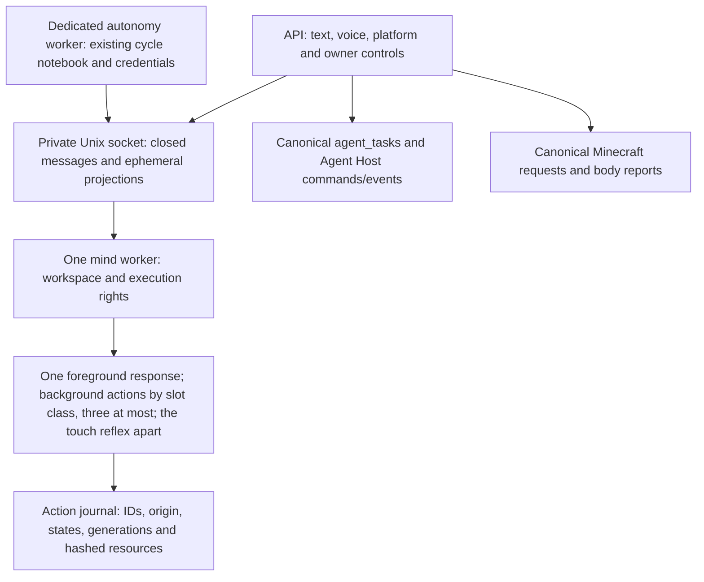

# Action threads and the shared mind

Status: implemented on `codex/shannon/adr8-stage4`; independent source review passed on runtime `12dd3688`, production rollout pending. See [verification evidence](action-threads-implementation-report.md).
Revision: 2026-10-08. Production remains Stage 3 (`16bdf384`).

Stage 4 is explicitly enabled by `SHANNON_ADR8_STAGE4=on`, with the Stage 3 workspace enabled. OFF retains the in-process Stage 3 mind, its conversation and autonomy behavior, and the existing device protocols. The new owner route returns 404 while OFF, so older servers do not produce a broken control in the apps.

## One owner, three execution slots

`mindWorker.ts` constructs the only Stage 4 `MindHost` after acquiring socket ownership. `infra/sqlite/mindOwnership.ts` holds an OS-backed SQLite writer lock in a separate private file for the worker lifetime; process death releases it. This also serializes stale-socket recovery. The socket directory is owner-only (0700), the socket and ownership file are 0600, and an existing symlink or foreign-owned path is rejected.

The API keeps a bounded projection, not another mind. Owner words in transit are ephemeral. The workspace journal contains closed events and references, never a conversation, task goal, file path or memory text. Workspace rendering re-reads the current memory snapshot after IPC, so forgetting or a changed audience wins over a previously captured snapshot. A late perception response cannot become the next turn's context. A disconnected or expired projection is dropped.

The action journal records `respond`, `ownTime`, `agentTask` and `minecraft`. The originating notebook remains authoritative: autonomy cycles, `agent_tasks`, and Minecraft requests are not copied into a replacement task system. Source IDs deduplicate scheduling. Origin and parent cannot change; descendants inherit origin and owner-informed status. A subsequently marked autonomy cycle marks its existing action too. Minecraft and Agent Host creation from her own time remain withheld by the existing tool-surface policy.

## Rights, stop and recovery

| State | Meaning and permitted next action |
| --- | --- |
| queued | No side effect has begun; admission waits for a slot and its resources. |
| running / waiting | A live generation and holder may renew; each outside operation checks its rights immediately before sending. |
| stopping | No new dispatch; the already sent operation retains resources until an acknowledgement. |
| completed / failed / cancelled | Known terminal outcome. Own-time failed/cancelled work can be explicitly resumed below the failure limit. |
| unknown | A sent result is uncertain. No automatic retry or owner resume; only the original canonical outside acknowledgement reconciles it. After the unknown exit it holds no slot (result `unknown_retired` or `outcome_unknown_closed`). |

Leases last 30 seconds and live runners renew every five seconds. Generation, holder and deadline are checked at dispatch, checkpoint and finish. An expired sent lease becomes `unknown`, with a new generation fencing old progress; an expired not-sent lease becomes `cancelled`. Unknown work retains its slot and resource keys for `UNKNOWN_EXIT_MS` (10 minutes, stabilization 2026-10-12); the step of an FCA work task (research, generic; model-only) only for `UNKNOWN_EXIT_MODEL_ONLY_MS` (3 minutes, 2026-10-13: its model request has its own 90 s deadline, and two research steps left unknown had held both research slots while the owner's next question waited). A decision request the provider answered with a server error (5xx) is not unknown: the task fails at once with its report, nothing resent, its spend still booked as unknown. It then leaves by the one unknown exit (Syzygy ADR-0009 stage 1, S5; `unknownExit`, times compared as parsed instants): the sweep clears `sent` and sets the result to `unknown_retired` for the step of a model-only FCA task or `outcome_unknown_closed` for anything that may act outside (a new notice episode); the slot and the base resources are free again, and an Agent Host task whose action closed this way is itself closed as failed with that outcome (not a release proof of its Host lock). A dispatch-added resource that has a domain release proof (the configured Minecraft body) stays excluded until `action.reconcileResource` proves its release; added locks without such a proof (study, folders) are released with the slot, since nothing could ever prove them and they would block their domain forever. An own-time cycle whose own action was released this way can never claim it again, so the loop ends that cycle (and its session) with end code `action_unknown`, unreplayed, and the next cycle starts with a fresh action. The state stays `unknown`, is never resumed or replayed, its held budget stays held, and a late canonical acknowledgement still closes it. A renewal that fails in transport or on a busy database is tolerated twice while the last confirmed lease is still valid; a definitive refusal ends the attempt at once. A canonical terminal acknowledgement can close only the immediately previous generation and its original holder. Agent Host also ignores completion from a different Codex turn ID. A stop request is not reported as stopped until the outside turn/body acknowledges it.

Slots (Syzygy ADR-0009 stage 1, S6): every action has a slot class (`respond`, `touch`, `creative`, `research`, `minecraft`, `codex`, `sleep`, `other`), and a claim is admitted only while its class and its pool are below their limits as `mind_action_slot_pools` and `mind_action_slot_classes` hold them (`slotAdmissible`). The owner's limits of 2026-10-12 (schema step 011): one foreground slot; three background slots in all, with creative 1, research 2, Minecraft 1, Codex 1, sleep 1 and other 1; the touch reflex in a pool of its own with one. A live action and a sent unknown non-respond action hold a slot. Refusals are counted by closed reason (`pool_<pool>`, `class_<class>`, `resource_held`, `failures`, `not_queued`) in `GET /v1/ops`. Rolling back restores the old fixed limits (one foreground, two background); the rows stay and the old build does not read them.

Outside the action store, an action's lease is read in one way (Syzygy ADR-0009 stage 1, S1): `ActionLeaseReader` (`mind/action/threads/store/actionLeaseReader.ts`) reads synchronously on the caller's own connection, so a caller inside its transaction keeps it as its commit fence, and the judgement is the one pure `leaseLive` of `@shannon/mind` under a named rule (`LEASE_RULES`). Since S5 there is one clock and one deadline rule: every reader compares parsed instants and the action's deadline ends the lease (before, the readers outside the store compared ISO text, and only the store's check and the Minecraft lifecycle honoured the deadline; `actionLeaseEquivalence.test.ts` holds the readers to the old predicates under exactly these two changes). The rules keep only which states each reader acts in: the store's check counts running and waiting; an FCA or conversation step, the Minecraft body and its lifecycle count running only; the FCA recovery (`classifyLease`) and the store's settle count every live state. The store's `finish` still accepts a live lease past its deadline (kept on purpose: a just-late attempt records its real outcome instead of an unknown). Only the action store and the migrations name the table.

Canonical own-time reports and Minecraft terminal acknowledgements use private durable outboxes. An interrupted IPC delivery retries only the recorded acknowledgement, never the model, tool or body request. Own-time usage is recorded in the same transaction as its closed acknowledgement; the mind records an idempotent receipt before the canonical outbox is cleared. A known result delivered after expiry releases only the original attempt's reservation and resources, without granting fresh execution rights. A lost provider response or response body remains uncertain. Minecraft's authenticated claim that omits an old held request is its existing canonical abandonment acknowledgement; silence or lease expiry alone does not acknowledge the outside action. Lost Codex RPC results retain an uncertain host session, original turn identity and resource lock across restart.

Stop-one and stop-all use a request ID and propagate to descendants, excluding the foreground conversation. A queued action cancels immediately. An accepted stop whose HTTP answer is lost is read back; the app never automatically posts the same mutation again. A stale report, recovery, or others present removes controls. Parent termination prevents child resume. Five consecutive identical failures close the action and disable its resume. The own-time limit counts actual step failures, not worker restarts.

A conversation recovery path serializes turns locally while the mind is disconnected. It permits conversation and reads, while outside writes require the mind to reconnect. Accepted long conversations do not retain the four-second admission deadline. Resource contention waits with lease renewal and cancellation; it never grants a write merely because a timer ran out. Tool gates, owner/audience rules and path rules are checked again after the wait. The current local Mac Agent Host shares the coarse Mac-folder lock with folder tools, so a host task and a conversation cannot write that folder together; the cloud host retains its own resource.

## Budget and privacy

Own-time calls retain their dedicated credentials and the canonical daily 2,000 yen cap. Atomic reservations prevent two actions from spending the same remainder. A reservation is released only after the canonical spend ledger records known usage or after a known not-sent refusal. A lost result retains its estimate. An explicit owner request cannot relabel existing own-time work or its descendants to escape the budget. Existing outreach, owner-document, protected-core and proposal approval gates still apply.

`GET /v1/action-threads` and stop/resume routes require the authenticated owner scope. Client-supplied scopes cannot change authority. Summaries expose generic action-kind titles and closed progress/result codes, with no runner, resource, source, task goal or private words. Server body/OBS audience and client audience both withhold detail; uncertainty is private. The apps show only 「作業中」 while others may see/hear them.

The foreground has its own slot, so the own-time loop can continue thinking and working during conversation. This does not loosen the rules for starting a message, showing owner-informed work, making a call or sending a push. Those delivery gates still check conversation and audience at the actual delivery point.

## Apple surface

Talk has a small 「裏で n 件」 capsule. It opens a native iPhone sheet or Mac popover with origin and a word/icon state, stop-one, stop-all and explicit own-time resume. The dialogue/figure location has a compact matching entry. The existing composer and navigation stay primary. Unknown, stopping, five failures, recovery, stale reports, empty, others present and old-server absence have explicit states. A known stopped own-time action retains a 「停止済み」 entry for explicit resume even when nothing is running. Controls have at least 44-point targets; native dismissal restores capsule focus. No custom motion is required.

Copy comes from `design/strings.ja.json`. The DEBUG-only `ShannonPreviewActionThreads` fixture uses synthetic data and no server; `ShannonPreviewActionState=unknown|recovering|others` exercises uncertain states. These flags are used only with the existing design-preview connection store.

## Validation and rollout

Deterministic tests cover slot admission, lease/generation fencing, resource contention, stop acknowledgement, request read-back, reservations, five failures, stale Codex completion, actual own-time execution, retained outreach gates, server audience, forgotten memory and socket ownership/reconnection. Swift tests cover late replies, server/client audience changes, stop read-back and old-server absence. Apple build, visual and latency evidence is recorded in the [Stage 4 implementation report](action-threads-implementation-report.md); these are not evidence of a TestFlight install.

Before rollout: independent core review, all regression and architecture checks, VM typecheck/tests, DB backup and integrity check, plus the seven Apple release gates for distribution. Install the new API and Agent Host protocol while the switch is OFF before enabling Stage 4; older hosts are refused when ON. Register `deploy/azure/shannon-ios-mind.service` with the existing private environment file. Then explicitly enable Stage 4 for API, mind and autonomy together and verify one mind, lease recovery, auth 401, data counts and all services. A local measurement does not replace VM latency verification. Leave Sonnet and budget changes outside this rollout. The [operator rollout procedure](action-threads-rollout.md) includes the quiet interval, both Agent Hosts, effective units and separate Apple gates.

For recovery, inspect canonical task/body outcomes before reconciling unknown work. Never fabricate an acknowledgement or delete a resource lock to make a task run. Switching OFF is a rollout recovery measure; restoring intended Stage 4 behavior still requires resolving the root cause.

## Candidate original-resource acknowledgement

`action.reconcileResource` is private mind IPC, not an owner HTTP tool. Its default-deny proof runs inside the action writer transaction and can remove only a dynamic resource from an original unknown lease (generation minus one / last holder). Immutable acknowledgement IDs retain exact payloads. It never clears unknown action state, sent/result, base or other resources, or budget reservations. The configured Minecraft proof re-reads accepted original lifecycle receipts and all original physical commands. The adapter and writer both require actual input release; matching current state is insufficient. Native command insertion also rechecks lease/resource ownership under `BEGIN IMMEDIATE`, fencing both orders of the cleanup/release race.

## 結果不明の通知確認（実装ブランチ）

所有者が通知を読んだことを別表に記録する。unknownの実行を解決せず、状態／lease／資源／予算／owner_informedを更新しない。確認済みでも不明な行と記録への入口を保ち、新しい不明episodeは再通知する。API・画面・不確かなPOSTと同席時の契約は [action-notice-acknowledgement-contract.md](action-notice-acknowledgement-contract.md)。
