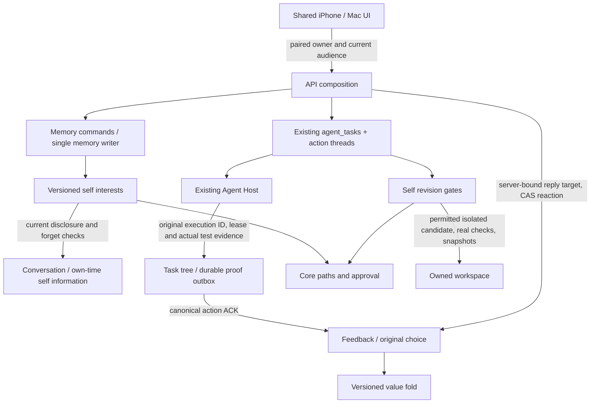

# ADR-0008 Stage 5: interests, task tree, feedback and self revision

Status: implemented on `codex/shannon/adr8-stage5`; individual deterministic checks and unlocked Mac launch smoke passed; the final full Swift repeat remains incomplete at the existing audio-device wait described in the report. Production deployment and TestFlight delivery have not been performed.
Verified coverage and remaining checks are recorded in the [implementation report](adr8-stage5-implementation-report.md); these results do not establish complete native or device acceptance.
Owner: Shannon task. Approved plan: Syzygy `notes/adr0008-stage5-plan.md`, owner approval 2026-10-08 (UI C/B).
The release baseline is `8200c128`: Stage 4 and evidence decay were already enabled in production and Build 169/168 were confirmed on devices. This document describes the new branch; it is not evidence of a Stage 5 release.

## Switch and ownership

`SHANNON_ADR8_STAGE5=on` explicitly enables the new ports. Unset or `off` supplies no interests, task tree, feedback or revision writer and no new capability line or tool. Existing Stage 3/4 switches and their execution, stop, daily budget, conversation, memory and study behavior stay in force. Interests additionally require the memory outbox; feedback requires the choice ledger. The configured processes expose only abilities whose ports exist.

The same canonical execution engine (`agent_tasks`, action threads, original Host commands/events) owns work. A tree describes a task and its verifiable conditions; it does not execute code or grant authority. Memory commands and the memory writer own interests. Feedback and value versions share the conversation store's SQLite connection. The sleep worker has only a read-only task-proof connection; it cannot dispatch or claim work. The own-time process receives narrow public functions for self information and revision, never the private conversation store or conversation credentials.

## Interests

`mind/self/selfInterestMemory.ts` and `store/sqliteSelfInterests.ts` persist immutable item versions, individual changes, owner operation receipts and real-night limits. The writer reaches them through `mind/memory/selfInterestHandlers.ts`; proposals are not a second write path.

- Legacy string interests remain valid. New structured interests start at weight 0.5, range 0–1; the index starts at version 0 and shows both forms without inventing historical evidence.
- At most 12 active entries and 1,000 characters for the whole index; stable descending weight order. In an owner's local night, net weight change per item is at most ±0.1, at most two additions and two deletions. Quotas are durable and are not refunded by undo. Night adoption runs even without a conversation sleep batch.
- Resonance creates candidates, not immediate facts. Current canonical owner utterances and disclosure are checked. Quoted/unknown/indirect provenance is held; new unverified model strings cannot bypass the structured writer as owner observations.
- Pin freezes nightly change. Undo compensates one selected change with CAS and freezes that item until owner resume. Ban and forget survive undo, rollback and restart. Forget also writes the canonical memory control in the same transaction.
- Every read rechecks current source visibility and forgetting, including old versions and original operation receipts. The compact self index is quoted data, not instructions or rights. Detail-only evidence is bounded canonical text after the same checks; absent/unknown evidence does not expose its original words.

Owner API: `GET /v1/autonomy/interests`, `GET …/{id}`, `GET …/operations/{operationId}`; `POST …/{id}/{pin|unpin|ban|unban|forget|undo|resume}` with `operationId`, `expectedRevision` and, for undo, `changeId`. A stale version or reused operation with a different request is 409. Operation read-back returns the original result separately from the latest snapshot. Private audience is checked before and after body reading, before mutation and before response.

## Task tree and original proof

`packages/mind/taskTree.ts` holds pure contracts. `mind/action/agentTasks/store/taskTreeStore.ts` uses the existing task database/transaction and callbacks run after commit. The Host receives the exact approved tree through the existing start/resume/steer request.

Nodes hold parent, stable order, dependencies, purpose/result, deterministic checks, constraints, boundary and stop conditions. Duplicate IDs, dependency/parent cycles and weakening a child's inherited boundary are rejected. Root purpose/content/deadline changes need an exact owner proposal approval (revision + diff hash). Replanning cannot change origin, budget lane, permissions or owner-informed status. Existing tasks are grandfathered as unknown/legacy; they continue ordinary execution and receive no invented proof or historical choice credit.

Completion proof requires the original task, node/tree revision, attempt/command, execution turn, action ID, generation/holder and actual passed check evidence. Prose, a `passed` boolean, a thumb or a prior attempt's test cannot finish a node. Unknown work waits for the original acknowledgement; it is never recreated in a fresh execution merely to find out what happened. A late original ACK is accepted once. Task feedback additionally waits for the canonical action's completed ACK with the same action/last holder and original or recovered generation.

Owner API: `GET /v1/agent/tasks/{id}/tree`, `POST …/replan`, `GET|POST …/proposals`, `POST …/approve`. Proposals have stable operation IDs. Clients retain an uncertain operation and read back its original proposal/approval; they do not automatically submit another POST. Existing start, pause, resume, steer, cancel and approval controls remain.

## Feedback and value learning

`mind/learning/feedbackService.ts` binds only genuine tool execution in an owner-alone text/voice turn or a verified owner-requested task's saved result note. The server supplies an opaque target and revision, never a client claim about execution. Exact whole-thread source lookup, source digest, owner speaker, current forgetting/deletion/disclosure and current audience are required. A bounded display history is not evidence. Raw tool trace cleanup does not remove the immutable, content-free provenance already established for a target; no raw paths, arguments, results or private titles enter the reaction DTO.

The result note uses fixed wording and a deterministic message ID per original attempt. Host prose is not copied. Its original owner-alone visibility survives retries; a note first written with others present cannot later become a private feedback target by retrying the callback. Original action IDs are persisted with dispatch and verified outbox entries and are read through the scoped canonical `action.get` port before commit-free callback delivery; the bounded latest-40 display list cannot hide an old receipt. Unknown canonical receipts stay pending and a timer retries only the durable receipt, never a Host command or model call.

`GET|POST /v1/feedback`: owner pairing and current owner-alone gate, target + thread, expected revision + operation ID. Reactions are `good`, `bad` or `null` (withdrawal). GET with operation ID reads the original accepted reaction separately from current latest revision. Stale requests return 409. An unknown POST remains checking and is reconciled by GET; no automatic POST retry. Old/unbound responses have no buttons.

For the same original choice, serve combines its natural score (80%) and current valid thumb (20%). No second choice, extra reward, mood appraisal, cost settlement or tier call is generated by a thumb. Other reward components, original V and cost rules remain. Task execution is scored only for genuine owner origin, definite original proof and saved reply. Host per-task cost is currently unreported (existing ledger sentinel 0), not measured free execution; cost weight stays unchanged at 0. The original dispatch presence/V are frozen in the durable outbox before callback and survive delayed delivery/restart. Unknown original audience freezes a null V; missing original expectation is held rather than borrowing a later V.

Night folds use choice sequence, feedback sequence and source policy, so a late reaction makes a later value version even with no new choice. Rollback stays frozen until owner resume. Source forgetting revokes the reaction; unknown proof holds the fold. Reaction metadata is attached after the ordinary response/voice work, keeping first-sentence and first-audio generation on the existing path. Quantitative latency still requires release measurement.

## Self revision

`selfRewriteRuntimeWiring.ts` supplies actual authority, current action execution/lease, stop, budget, canonical work origin and physical workspace boundaries to the revision service. The own-time tools `workspace.inspect`, `workspace.rewrite`, `workspace.propose` exist only while the port is configured. No second process executor or new permission is introduced. REST cannot mint an execution lease. Existing owner-information provenance is attached to physical workspace paths before an isolated write; explicit reads of those files mark the original current cycle before returning content. Aliases share the same physical mark, and a mark read/write failure holds the operation before file I/O.

Gate order: provenance → stop/ban → same-work failure freeze/unknown → original rights and budget → physical paths/core map → exact owner grant when required → deterministic tests → guarded diff → before/after snapshots. Every write rechecks current ownership and base. Five known failures freeze the same work (a new candidate ID cannot reset it); only owner resume releases the freeze. Known success resets the failure count. The durable applying state is committed before executor dispatch. A restart during validation is closed as known not-dispatched without retaining execution rights or blocking the work. A restart after applying begins or a partial write remains unknown and retains snapshots until the original result is reconciled.

The TypeScript 5.9.3 parser is a declared API runtime dependency (already pinned in the workspace lockfile); frozen offline installation verifies it. Free isolated changes have actual closed checks for JSON, plain text, Markdown and pure numeric utility code with exact test vectors. Code checking consumes the whole parsed module, rejects strict/module reserved bindings and accepts only the bounded supported grammar; external access, arbitrary identifiers, dynamic execution and unsupported behavior are not inferred safe. Other code changes retain the existing Host task/proposal path and cannot apply without matching actual verification. Core, production and sibling/owner paths require the exact difference/base/generation owner grant and an appropriate executor; a grant does not create one. Ordinary existing folder edits remain available. Gate input inspection decodes every JSON string token, including duplicate keys and escaped nested content; content depth has its own bound and scan-budget exhaustion explicitly holds rather than silently omitting a suffix.

Owner routes under `/v1/autonomy/self-rewrite/`: candidate submit/read, exact candidate approval, dispatch, and work read/resume. These are paired private routes and grants are not model/tool input. The protected path map includes the new gates, writers, feedback, revision helpers and wiring.

## UI and rollout

Approved C/B: 関心の日記 has current entries and changes, detail reasons/evidence/versions and the existing control meanings; a small pair of reaction controls belongs to the bound response; the existing work detail shows the task tree and condition proposals. Existing ようす 今/学び/気分, Talk/voice/memory/study and task controls remain. iPhone and Mac share models/meaning with native navigation. No new peer tab. Current audience changes clear the new private projections and fence delayed reads without discarding unknown operation receipts.

Architecture enforcement keeps the original rules unchanged. Physical responsibilities moved from transport into perception/attention/inhibition/memory, store constructors moved to wiring, and pure rule/frame ports avoid runtime cycles and private worker reachability. The layer baseline is zero; no new exception was added. The 500-line guard applies to all new source.

Before release: full API/package regression, Apple shared tests and both unsigned targets, static/layer/entry closure/core protections, temporary database restart/OFF compatibility and original-ACK/privacy tests, native synthetic visual QA, then the existing production and seven Apple release gates. Do not treat builds or fixtures as device/TestFlight acceptance. Start the release with Stage5 OFF; enable it only for the reviewed production change after backup/health/authentication/row-count checks. To contain a fault, switch OFF and restart the affected existing processes. Preserve additive tables and receipts; OFF is containment, not a permanent fix. Diagnose and restore the intended feature before claiming a fix.
