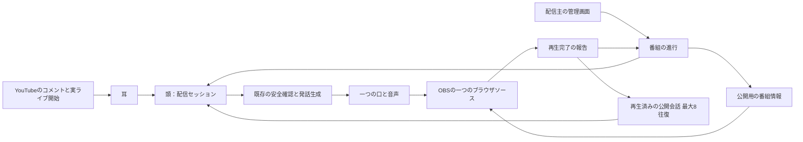

# シャノン AI VTuber：雑談番組の進行と公開文脈（2026-10-30）

状態：ライ氏の設計承認を受けて作業枝で実装。VM反映・main merge・新しい配信は未実施。

## 作り

- 頭の StreamProgram が opening（挨拶）→explanation（企画説明）→activity（雑談・企画）→closing（締め）を持つ。
- 実ライブ開始は耳が videos.list の actualStartTime と actualEndTime で確認する。チャットIDが見つかっただけでは挨拶・返答・実況を始めない。開始待ちの間もコメントは受け取る。
- 挨拶と企画説明は spoken receipt の後に次へ進む。失敗・スキップでは説明済みにせず、5秒後から再試行する。生成だけでは completed に足さない。
- 雑談には目安の期限を置くが、自動では締めない。配信主が「次」「前」「5分延長」「締めへ」を選ぶ。締めの再生が済んだら新しい返答・独り言を作らない。
- シーン変更時に世代を進め、古い場面で始めた返答・独り言・進行発言の生成結果を破棄する。今しゃべっている行は最後まで流す。「今の行を止める」は別の明示操作。
- コメントの安全確認・書き手・単一の口・再生報告は既存経路を使う。毎コメントに追加の進行判断モデルを直列に挟まない。通常の番組では挨拶・説明・締めの3発言が進行のために必要。

## 文脈の範囲

StreamConversation は再生済みのコメントと返答を組にして8往復だけ保持する。直前の話題、シャノンの問いかけ、未回答の問いを文脈として書き手に渡す。独立した永続メモリや要約モデルは増やさない。短い「シャノンは？」を直前の会話へ結び付け、曖昧なら確認するように指示する。

入力は、この配信のお題・参加方法・配信主が明示した公開資料と、配信内の実際の会話だけ。所有者のプロフィール・私的記憶・好感度・Muse・道具には接続しない。拒否したコメントは原文を次の会話文脈へ入れず、公開できない依頼を断った事実に丸める。OBSに返答対象の危険な原文を表示することも避ける。

終了でコメント本文・会話文脈・公開資料を捨てる。配信終了後もコメント件数・モデル呼び出し・トークン・遅延の数値は保持し、「計測値だけを保存」でJSONに出せる。保存内容は既知の数値項目だけで、任意の文字フィールドを通さない。

限界：8往復より前の会話や未採用の生コメントを長期追跡しない。意味のつながりは書き手の理解に依存し、実モデルでの次回配信による答え合わせが残る。説明済みとは、その場面の発言が音声で完了した意味であり、文章に必要事項が含まれたかを別モデルで採点したものではない。

## 画面

番組の段と画面を分け、talk / board / game / ending の4種類を管理画面で選ぶ。通常は雑談の画面のまま進み、終了操作ではエンディングへ変わる。資料画面は今回、お題と参加案内のカード。任意のスライドや画像のアップロード機能は含めない。

OBSは同じ stream.html を読み続ける。公開投影（場面・お題・参加案内・画面・完了した場面・期限）だけを頭のstateイベント→デスクトップ→ローカルのprogramイベントで渡す。公開資料の本文や管理用のコメント一覧をOBSへ渡さない。画面変更でページや音声SSEを再接続しない。game画面の中央は透明で、OBSで下に置いたMinebotの映像が見える。

## 次の限定公開テスト

1. @Rai_at_aiminelab の限定公開動画URLを管理画面で指定。URLから動画IDだけを取り、セッションへ渡す。OAuthのチャンネルやVMの環境変数は書き換えない。
2. お題ひとつ、参加案内、公開資料、雑談の目安時間を入力して準備する。
3. YouTube開始前には声が出ないことを確認。ライ氏の別途承認を得た後にYouTubeで開始する。
4. 挨拶→説明が実再生後に進み、同じ話題の「どうして？」「シャノンは？」に答えられるか確認する。
5. 資料画面に切り替えて音が切れないことを確認。5分延長、前後、締めの挨拶を試す。
6. 締めの完了後に受付を終了し、音声の完了を見てからOBSとYouTubeを停止する。数値だけを保存する。

## 遅延を8秒へ近づける見込み

10/30の実配信はコメント→音の中央値23秒、行生成→音1.8秒。前者と後者は別集団の中央値なので、引き算を工程の実測として扱わない。以前の台での12秒とも条件が異なる。

今回、published→received（取得）、received→選択、安全確認、書き手、行生成→音、published→音を計測する。モデル呼び出し・トークンも記録する。下表は測定値ではなく、低負荷で返答待ちの列がほぼ無い場合の予算案。

|工程|次の実測で確かめる目標|
|---|---:|
|YouTubeから頭へ届く|0.7秒|
|選択までの待ち|0.5秒|
|安全確認|0.5秒|
|返答の生成|4.5秒|
|音声生成・再生開始|1.8秒|
|合計|8.0秒|

- 今回の進行追加による毎返答のモデル往復増分は0回。公開文脈のトークン分だけ生成費用・時間が増える可能性があるため、8往復に制限した。
- 次の実測で選択待ちが中央値1秒程度なら、2秒ごとの選択をコメント到着時の即時選択へ変える案で約0.5秒短縮を狙う。6秒の返答間隔と総モデル呼び出し上限は維持する。
- 書き手が6〜8秒かかっていれば、同じ人格・安全確認のまま公開文脈の重複を減らし、返答を短くして4.5秒へ寄せる。予測短縮は1.5〜3.5秒。モデル変更は実測と品質比較の後で判断する。
- 取得待ちや音声の順番待ちが主因なら、モデルを速くしても8秒には届かない。streamListの再接続理由・受信時刻・口の順番待ちを先に調べる。
- この変更で8秒を達成したとは報告しない。実配信の再測定と費用の照合が必要。

## 配備の条件

頭・耳・デスクトップを合わせて検証する。新しい頭は旧耳からonAirが来なければ待機するため、安全側に止まる。VMへの反映・再起動・設定変更、main merge、新しいYouTube配信、費用のかかる長い実走は、ライ氏の承認を得てから。反映前に取りまとめ役へ一声。設定を送る場合はLF・事前の控えを守る。
